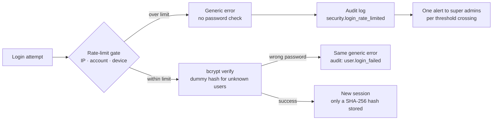
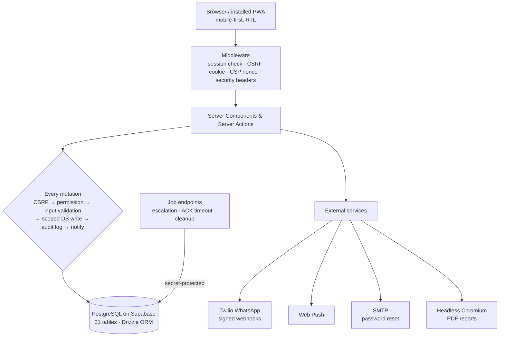

  <h1>🛡️ ON-IT</h1>

  <h3>Secure Operations Platform: Incident Ticketing, Workforce Tracking & Security Monitoring</h3>

  

    <strong>Incident lifecycle · SLA & escalation · Role-based access control · Audit logging & security alerting</strong>
     
    A production pilot used every day by a real operations team. Hebrew RTL, mobile-first.
  

   

  
  
  
  
  

    

  
  
  
  
  

 

> **About this repository:** ON-IT runs in a live pilot, so its source code is private. This page documents what I built, with a focus on the security engineering, monitoring and incident-handling work. I'm happy to walk through the code in an interview.

---

## 👋 About Me

I'm **Yonatan Nakash**, a cybersecurity student. I designed, built and operate ON-IT end to end: the database schema, the access-control model, the production deployment, the security testing and the fixes that came out of it.

I'm looking for roles as a **SOC Analyst (Tier 1)**, **Security Analyst**, **Junior IT / Technical Security** or **Technical Support Engineer**.

---

## 🎯 Skills Demonstrated

| Area | What I did in ON-IT |
|:---|:---|
| 🚨 **Security monitoring & alerting** | Built detection for brute-force and credential-stuffing attempts. Each threshold crossing is written to the audit log and raises one alert to administrators, with a cap to prevent alert fatigue |
| 📜 **Log analysis & audit trails** | Designed an audit log with 60+ event types (logins, failed logins, permission denials, role changes, session revocations, config changes), searchable by user, action, entity and date |
| 🎫 **Incident handling** | The product is an incident workflow: triage, assignment, acknowledgment deadlines, SLA tracking, escalation and closure |
| 🔑 **Identity & access management** | 12 roles × 41 permissions, least privilege, data-scope filters enforced in SQL, fail-closed permission resolution |
| 🐞 **Vulnerability remediation** | Ran a penetration test and a full security audit. Fixed IDOR, a timing side channel, header spoofing, information leakage, HTML injection and formula injection |
| 🌐 **Web application security** | CSRF protection, nonce-based Content Security Policy, HSTS and security headers, schema validation on every input, hardened cookies |
| 🔒 **Authentication & sessions** | bcrypt password hashing, hashed session tokens, idle + absolute session limits, session revocation, single-use password-reset tokens |
| 🛠️ **Technical support & operations** | Running the system in production: releases and rollbacks, user support, troubleshooting email and WhatsApp delivery, kill switches and maintenance mode |
| 📝 **Security documentation** | Security, access-control, architecture and known-issues documents maintained as project deliverables |

---

## 🎬 Screenshots

<table>
  <tr>
    <td align="center" colspan="2">
      <strong>🏠 Admin Dashboard</strong>
        
      
    </td>
  </tr>
  <tr>
    <td align="center" width="50%">
      <strong>📋 Ticket Board: filters, stats & SLA tracking</strong>
        
      
    </td>
    <td align="center" width="50%">
      <strong>👥 Attendance Management</strong>
        
      
    </td>
  </tr>
  <tr>
    <td align="center" colspan="2">
      <strong>📊 Reports Hub: PDF, Excel & CSV export</strong>
        
      
    </td>
  </tr>
</table>

---

## 🚨 Security Monitoring: Brute-Force Detection

Login attempts pass through a layered rate-limit gate **before** any password check. Limits are tracked per source IP, per account, per IP + account pair, and per trusted device, each with a short burst window and a longer sustained window.

**Design decisions:**
- **No username enumeration.** Unknown, inactive and wrong-password logins get the same message and the same work (one bcrypt check against a dummy hash), so neither the response nor its timing shows whether an account exists.
- **Shared NAT friendly.** IP limits count failures only, so many users behind one office IP aren't locked out by each other.
- **Trusted devices.** A browser that has signed in to an account before is throttled on its own counter, so an attacker can't lock the real user out of their usual device.
- **Spoof-resistant client IP.** The client IP comes from the hosting platform's header, not the attacker-controlled left-most `X-Forwarded-For` value.
- **Event-based alerting.** An alert fires once when a threshold is crossed, not on every request. A global hourly cap stops an attack from flooding admins. Suppressed events still go to the audit log.
- **Fail closed.** If the rate-limit store is unavailable, login is refused.
- **Pseudonymised keys.** IPs and usernames are hashed before they are used as rate-limit keys.

---

## 🧯 Incident Response Example: Suspected Account Attack

The tools an administrator uses when the brute-force alert fires:

| Phase | What happens in ON-IT |
|:---|:---|
| **1. Detect** | An in-app security alert reaches the super admins: which scope crossed its threshold (IP, account or device) and when |
| **2. Triage** | Filter the audit log by `security.login_rate_limited` and `user.login_failed`, by user and time range. Check whether a successful `user.login` followed the failures |
| **3. Contain** | Revoke all of the account's sessions in one click, reset its password, or deactivate the account |
| **4. Recover** | The user sets a new password through a single-use, 1-hour reset link sent by email |
| **5. Review** | Every containment step is itself audited (`session.revoke_all`, `user.password_admin_reset`, `user.deactivate`) with the admin, time and IP |

---

## 🔐 Security Engineering (Defense in Depth)

<table>
  <tr>
    <td width="50%" valign="top">

#### 🔑 Authentication & Sessions
- Passwords hashed with **bcrypt (12 rounds)**, never stored in plaintext
- Session token = 32 random bytes. Only its **SHA-256 hash** is stored, so a database leak doesn't give working sessions
- **Idle and absolute session limits** checked on the server on every request. Privileged admin sessions get shorter limits
- Sessions can be revoked one at a time or all at once; deactivating a user ends their sessions
- New users get a random temporary password and must change it on first login
- Password reset: single-use hashed tokens, 1-hour expiry, rate-limited per IP and per target account

</td>
<td width="50%" valign="top">

#### 🎭 Authorization (Least Privilege)
- **12 roles in a hierarchy, 41 fine-grained permissions**
- Permission checked at the entry of every mutating action
- **Scope filters compiled into SQL `WHERE` clauses**: users only see tickets, people and attendance inside their unit or department
- Single-row loads use the same scope filter. Out-of-scope and missing rows return the same "not found", so row existence doesn't leak (IDOR prevention)
- Permission resolution **fails closed**. Refused permission checks are audited as `security.permission_denied`
- Sensitive admin areas need a permission **and** an email allowlist

</td>
  </tr>
  <tr>
    <td width="50%" valign="top">

#### 🌐 Web Application Hardening
- **CSRF** double-submit token with timing-safe comparison on every state-changing action
- **Nonce-based CSP** with `strict-dynamic` and no `unsafe-inline` scripts, tested with an automated script-injection test
- HSTS (preload), `X-Frame-Options: DENY`, `nosniff`, strict Referrer-Policy, Permissions-Policy
- Cookies: `HttpOnly` · `Secure` · `SameSite`
- **Zod schema validation** with length caps on every user input

</td>
<td width="50%" valign="top">

#### 💉 Injection Defenses
- **Server-side PDF rendering:** user text is encoded at every output point, JavaScript is disabled in the headless browser, outbound requests go through an allow-list, and a strict meta-CSP blocks the rest
- **CSV / Excel formula injection:** cells that start with `=`, `+`, `-`, `@` (including full-width and hidden-character variants) are neutralised. A hostile test dataset went from **211 outbound connections to 0**
- **Phishing relay:** URLs are stripped from stored text before it is re-sent through the official WhatsApp sender

</td>
  </tr>
  <tr>
    <td width="50%" valign="top">

#### 🔗 Integration Security
- **Twilio webhooks:** signature validated against a pinned canonical URL. Missing config means the endpoint rejects requests
- **Job endpoints:** shared secret in the `Authorization` header with a constant-time comparison. Missing secret disables the endpoint
- Secrets live only in server-side environment variables, validated at startup
- **Kill switches** for WhatsApp, email, push and background jobs, plus a maintenance mode, all changeable at runtime with a config history

</td>
<td width="50%" valign="top">

#### 📜 Audit & Accountability
- **60+ audit event types** across auth, security, users, permissions, tickets, attendance, sessions, notifications and settings
- Each row records who, what, which entity, old and new values, and IP
- Security-critical changes write their audit row **in the same database transaction**, so a change can't happen without its record
- The app never deletes or rewrites audit rows. Users referenced in history are deactivated, not deleted
- Audit viewer restricted to the top two admin roles

</td>
  </tr>
</table>

---

## 🐞 Penetration Test: Findings & Remediation

All 7 findings from a penetration test were fixed and verified:

| # | Finding | OWASP Top 10 (2021) | Fix |
|:---:|:---|:---|:---|
| 1 | **IDOR** on ticket actions (assign, status change, escalate, comment and more): any signed-in user could act on tickets outside their scope | A01 Broken Access Control | Scope filter in the `WHERE` clause of every single-row load; generic "not found" on a scope miss |
| 2 | **Timing side channel** in the job-secret comparison | A02 Cryptographic Failures | Constant-time comparison (`crypto.timingSafeEqual`) that is also safe on length mismatch |
| 3 | **Stack traces leaked** in report error responses | A05 Security Misconfiguration | Debug details removed from responses, logged on the server only |
| 4 | **Secret sent in the URL** query string, so it reached access logs | A05 Security Misconfiguration | Moved to the `Authorization: Bearer` header |
| 5 | **Malicious URLs relayed** through notification retries via the official WhatsApp sender | A03 Injection | URL stripping before re-send, plus length limits on ticket and comment input |
| 6 | **Rate-limit bypass** by spoofing `X-Forwarded-For` | A07 Identification & Authentication Failures | Client IP taken from the platform-controlled header or the right-most proxy entry |
| 7 | **Webhook signature replay** through a forged `Host` header | A08 Software & Data Integrity Failures | Signature checked against a canonical URL pinned in configuration |

Later, a **full security audit** of the system covered authentication, authorization, data integrity and operations. Fixes shipped in four release waves, each with a read-only production preflight, signed-in smoke tests after deploy and a ready rollback target. Highlights:
- Redesigned login protection (the layered gate and alerting described above)
- Removed the username-enumeration signal from login errors and timing
- Locked down the server-side PDF renderer against HTML injection and outbound requests
- Neutralised formula injection in CSV / Excel exports
- Added auditing of refused permission checks
- Replaced a fixed 24-hour session with idle + absolute limits after a production issue was found

---

## ✨ Product Features

| Module | Capabilities |
|:---|:---|
| 🎫 **Tickets** | Priority-based SLA deadlines · state machine (open → assigned → in progress → resolved → closed) · manual or automatic assignment based on role, facility, attendance and unavailability windows · acknowledgment deadline · bump, defer, escalate · internal and public comments · full event timeline |
| ⏱️ **Escalation engine** | Finds overdue tickets and unacknowledged assignments and escalates them. Each ticket is claimed atomically, so overlapping runs never escalate twice, and one failing ticket doesn't stop the batch. Runs as secret-protected job endpoints triggered from the operations panel |
| 👥 **Workforce attendance** | Shift check-in / check-out, daily status, time-range unavailability, planning up to 7 days ahead. Attendance feeds directly into auto-assignment |
| 🔔 **Notifications** | In-app, Web Push and WhatsApp (Twilio). Delivery status is tracked through signed webhooks. A WhatsApp failure never blocks in-app delivery |
| 📊 **Reports** | 7 report types plus an overview dashboard, exported to PDF (RTL Hebrew), Excel and CSV. Every report is filtered to the viewer's scope |
| ⚙️ **Admin & operations** | User management, role assignment, session viewer and revocation, audit log viewer, runtime settings (SLA, acknowledgment timeout), kill switches, maintenance mode, config history, operations dashboard |
| 📱 **PWA** | Installable mobile app experience, built mobile-first and right-to-left |

---

## 🏗️ Architecture

**Engineering highlights:**
- **Race conditions handled in the database.** Unique partial indexes allow only one active assignment and one pending acknowledgment per ticket.
- **Distributed rate limiting without Redis.** One atomic PostgreSQL upsert counts a hit against several keys, so every serverless instance shares the same counters.
- **Transactional audit.** Security-critical changes and their audit rows commit or roll back together.
- **Guarded database migrations.** Scripts are dry-run by default, and changing production needs an explicit confirmation flag.

---

## 🧪 Quality & DevOps

| | |
|:---|:---|
| **CI on every pull request** | Type check · lint · documentation-citation check · unit tests · production build · integration tests |
| **Unit tests** | 1,100+ (Vitest) |
| **Integration tests** | 600+ against a real PostgreSQL database built from the migration history |
| **End-to-end tests** | Playwright, including a CSP script-injection test |
| **Release process** | Read-only production preflight → deploy → public and signed-in smoke tests → documented rollback target |
| **Documentation** | Security, RBAC, architecture, subsystem, tech-debt and known-issues documents, kept in sync with the code |

---

## 🛠️ Tech Stack

| Layer | Technology |
|:---|:---|
| **Frontend** | Next.js 16 (App Router, Server Components), React 19, React Compiler, Tailwind CSS 4, shadcn/ui |
| **Language** | TypeScript (strict) |
| **Backend** | Server Actions, middleware, secret-protected job endpoints |
| **Database** | PostgreSQL (Supabase), Drizzle ORM |
| **Security** | bcryptjs, SHA-256 hashed tokens, CSRF double-submit, nonce CSP, Zod 4, DB-backed rate limiting |
| **Notifications** | Twilio WhatsApp, Web Push (VAPID), Nodemailer |
| **Reporting** | Puppeteer (PDF), SheetJS (Excel), Recharts |
| **Testing** | Vitest, Playwright, GitHub Actions |
| **Hosting** | Vercel |

---

## 📊 By the Numbers

| Metric | Value |
|:---|:---:|
| Roles / permissions | **12 / 41** |
| Database tables | **31** |
| Audit event types | **60+** |
| Pentest findings fixed | **7 / 7** |
| Report types | **7** + overview |
| Notification channels | **3** |
| Automated tests | **1,700+** |

---

## 🗺️ What I'm Working On Next

- **Multi-factor authentication** for administrator accounts
- **Scheduled escalation runner**, so SLA and acknowledgment escalation run on a timer, not only from the operations panel
- **Forwarding security events to an external log platform (SIEM)** for alerting outside the app
- **CSP violation reporting**, so a policy regression in production is visible

---

  > **🔒 The source code is private** because the system runs in a live pilot. Code walkthroughs are available on request.

