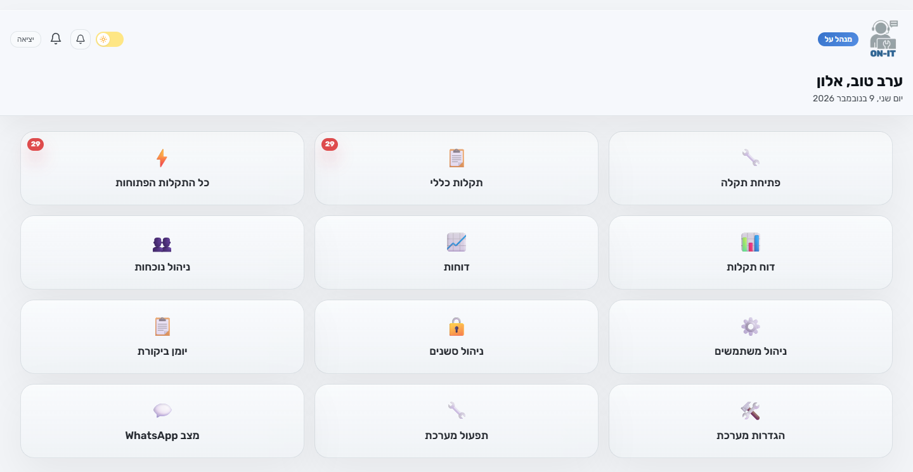
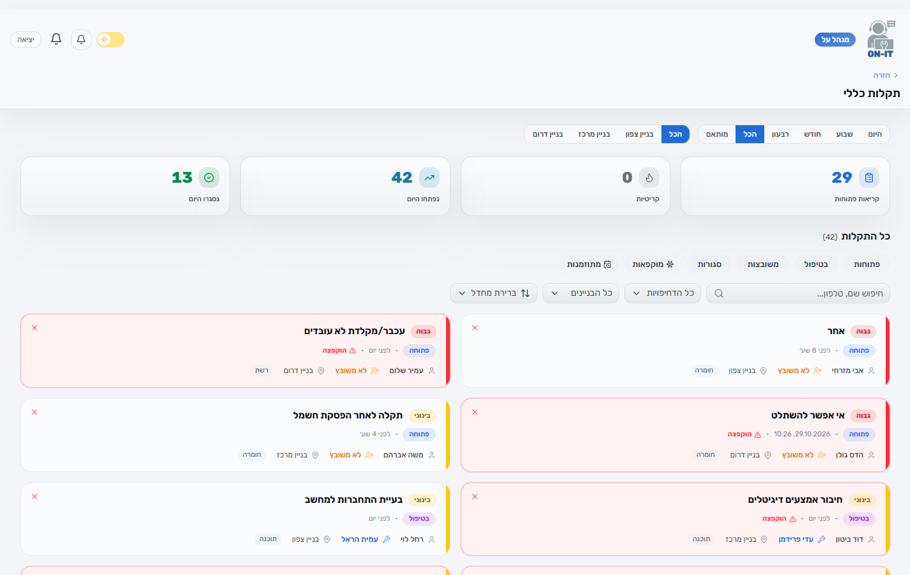
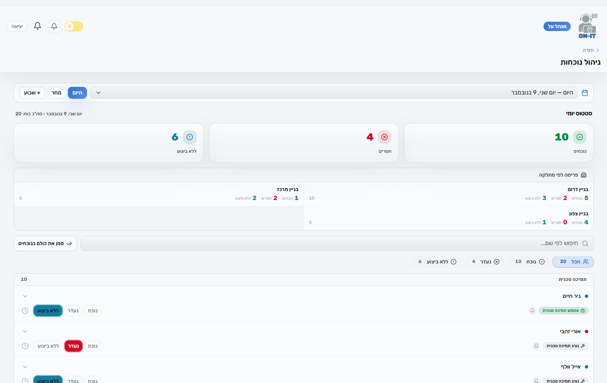
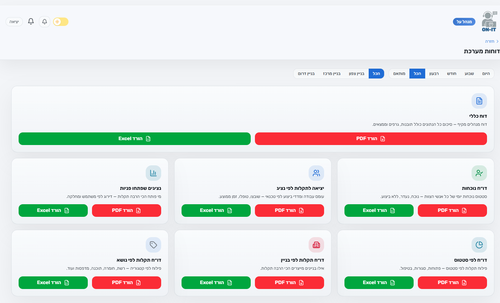
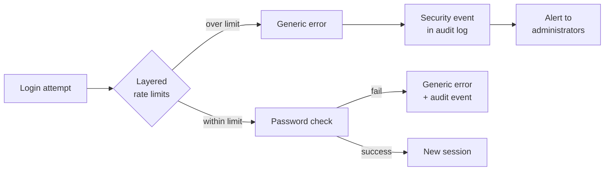
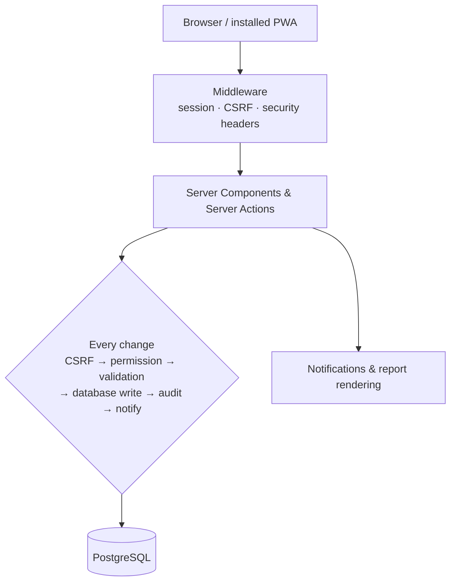

  <h1>🛡️ ON-IT</h1>

  <h3>Secure Operations Platform: Incident Ticketing, Workforce Tracking & Security Monitoring</h3>

  

    <strong>Incident lifecycle · SLA & escalation · Role-based access control · Audit logging & security alerting</strong>
     
    Built for Hebrew-speaking, mobile-first operations teams
  

   

  
  
  
  
  

    

  
  
  
  

 

> **About this repository:** ON-IT's source code is private. This page gives a high-level overview of what I built, with a focus on the security, monitoring and incident-handling work. I'm happy to go into more depth in an interview.

---

## 👋 About Me

I'm **Yonatan Nakash**, a cybersecurity student. I designed, built and operate ON-IT end to end, from the data model and access-control design to deployment, security testing and remediation.

I'm looking for roles as a **SOC Analyst (Tier 1)**, **Security Analyst**, **Junior IT / Technical Security** or **Technical Support Engineer**.

---

## 🎯 Skills Demonstrated

| Area | What I did in ON-IT |
|:---|:---|
| 🚨 **Security monitoring & alerting** | Built detection for brute-force and credential-stuffing attempts, with alerts to administrators and safeguards against alert fatigue |
| 📜 **Log analysis & audit trails** | Designed a searchable audit log covering logins, failed logins, permission denials, account and role changes, and configuration changes |
| 🎫 **Incident handling** | The product is an incident workflow: triage, assignment, acknowledgment deadlines, SLA tracking, escalation and closure |
| 🔑 **Identity & access management** | Role-based access control with least privilege and data-scope isolation between teams |
| 🐞 **Vulnerability remediation** | Ran a penetration test and a security audit, then fixed and verified every finding |
| 🌐 **Web application security** | CSRF protection, Content Security Policy, security headers, input validation, hardened cookies |
| 🔒 **Authentication & sessions** | Password hashing, hashed session tokens, session timeouts and revocation, secure password reset |
| 🛠️ **Technical support & operations** | Running the system in production: releases and rollbacks, user support, troubleshooting notification delivery |
| 📝 **Security documentation** | Security, access-control and architecture documentation maintained as project deliverables |

---

## 🎬 Screenshots

<table>
  <tr>
    <td align="center" colspan="2">
      <strong>🏠 Admin Dashboard</strong>
        
      
    </td>
  </tr>
  <tr>
    <td align="center" width="50%">
      <strong>📋 Ticket Board: filters, stats & SLA tracking</strong>
        
      
    </td>
    <td align="center" width="50%">
      <strong>👥 Attendance Management</strong>
        
      
    </td>
  </tr>
  <tr>
    <td align="center" colspan="2">
      <strong>📊 Reports Hub: PDF, Excel & CSV export</strong>
        
      
    </td>
  </tr>
</table>

---

## 🚨 Security Monitoring: Brute-Force Detection

- **Layered rate limiting** checked before any password verification
- **No username enumeration:** every failed login looks the same, whether or not the account exists
- **Event-based alerting:** one alert per threshold crossing instead of one per request, so admins aren't flooded
- **Fail closed:** if a security check can't run, the login is refused

---

## 🧯 Incident Response Example: Suspected Account Attack

| Phase | What the administrator does in ON-IT |
|:---|:---|
| **1. Detect** | Receives an in-app security alert |
| **2. Triage** | Filters the audit log by event type, user and time range to see what happened |
| **3. Contain** | Revokes the account's active sessions, resets its password, or deactivates the account |
| **4. Recover** | The user sets a new password through a secure, time-limited reset link |
| **5. Review** | Every containment action is itself recorded in the audit log |

---

## 🔐 Security Engineering (Defense in Depth)

<table>
  <tr>
    <td width="50%" valign="top">

#### 🔑 Authentication & Sessions
- Passwords hashed with bcrypt, never stored in plaintext
- Session tokens stored only as hashes
- Server-side session timeouts and revocation
- Temporary password with a forced change on first login
- Single-use, time-limited password-reset links

</td>
<td width="50%" valign="top">

#### 🎭 Authorization (Least Privilege)
- Hierarchical role-based access control with fine-grained permissions
- Permission check at the entry of every state-changing action
- Data-scope filtering enforced in the database queries
- Protection against IDOR: out-of-scope records can't be read or changed
- Refused access attempts are logged

</td>
  </tr>
  <tr>
    <td width="50%" valign="top">

#### 🌐 Web Application Hardening
- CSRF protection on every state-changing action
- Content Security Policy and standard security headers
- Hardened cookies (`HttpOnly`, `Secure`, `SameSite`)
- Schema validation on every user input

</td>
<td width="50%" valign="top">

#### 💉 Injection Defenses
- Output encoding in server-generated PDF reports
- Protection against CSV / Excel formula injection in exports
- Sanitising of user text before it is sent out in notifications

</td>
  </tr>
  <tr>
    <td width="50%" valign="top">

#### 🔗 Integration Security
- Signature validation on incoming webhooks
- Background job endpoints protected by a secret, compared in constant time
- Secrets kept only in server-side configuration

</td>
<td width="50%" valign="top">

#### 📜 Audit & Accountability
- Audit records for security-relevant and administrative actions
- Each record captures who, what, when and the change made
- Audit history is never deleted or rewritten by the app

</td>
  </tr>
</table>

---

## 🐞 Penetration Test & Security Audit

I ran a penetration test, and later a broader security audit of the system. Every finding was fixed and verified. The finding types, mapped to the OWASP Top 10 (2021):

| Finding type | OWASP category | How it was fixed |
|:---|:---|:---|
| Insecure direct object reference (IDOR) | A01 Broken Access Control | Scope checks enforced on every record lookup |
| Timing side channel in a secret comparison | A02 Cryptographic Failures | Constant-time comparison |
| Error details leaked in responses | A05 Security Misconfiguration | Generic errors to the user, details logged on the server only |
| Secret exposed in a URL | A05 Security Misconfiguration | Moved into a request header |
| Unsafe content relayed in outgoing messages | A03 Injection | Sanitising and length limits on input |
| Rate-limit bypass through spoofed headers | A07 Identification & Authentication Failures | Trusted source for the client IP |
| Webhook signature replay | A08 Software & Data Integrity Failures | Signature checked against a fixed, configured URL |

The fixes shipped in staged releases, each with pre-release checks, post-deploy smoke tests and a rollback plan.

---

## ✨ Product Features

| Module | Capabilities |
|:---|:---|
| 🎫 **Tickets** | Priority-based SLA deadlines · full lifecycle from open to closed · manual or automatic assignment based on role and availability · acknowledgment deadline · escalation · comments · event timeline |
| ⏱️ **Escalation** | Overdue tickets and unacknowledged assignments are escalated, with safeguards against duplicate escalation |
| 👥 **Workforce attendance** | Shift check-in / check-out, daily status and availability planning, linked to automatic assignment |
| 🔔 **Notifications** | In-app, push and WhatsApp, with delivery tracking |
| 📊 **Reports** | Multiple report types exported to PDF (RTL Hebrew), Excel and CSV, filtered to each viewer's access scope |
| ⚙️ **Admin & operations** | User and role management, session management, audit log viewer, runtime settings, operations dashboard |
| 📱 **PWA** | Installable mobile experience, built mobile-first and right-to-left |

---

## 🏗️ Architecture

---

## 🧪 Quality & DevOps

- **Continuous integration** on every pull request: type check, lint, unit tests, integration tests and a production build
- **Automated tests:** unit, integration (against a real database) and end-to-end (Playwright)
- **Release process:** pre-release checks, deploy, smoke tests, rollback plan
- **Documentation** kept in sync with the code

---

## 🛠️ Tech Stack

| Layer | Technology |
|:---|:---|
| **Frontend** | Next.js 16 (App Router), React 19, Tailwind CSS 4, shadcn/ui |
| **Language** | TypeScript (strict) |
| **Database** | PostgreSQL, Drizzle ORM |
| **Security** | bcrypt, CSRF protection, Content Security Policy, Zod validation, rate limiting |
| **Notifications** | WhatsApp, Web Push, email |
| **Reporting** | PDF, Excel, CSV |
| **Testing** | Vitest, Playwright, GitHub Actions |
| **Hosting** | Vercel |

---

  > **🔒 The source code is private.** More detail is available in an interview.

